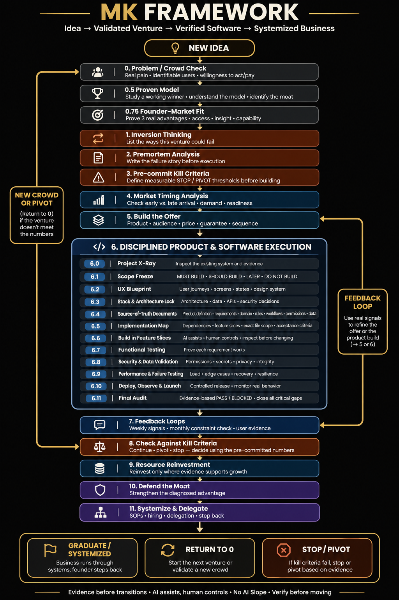
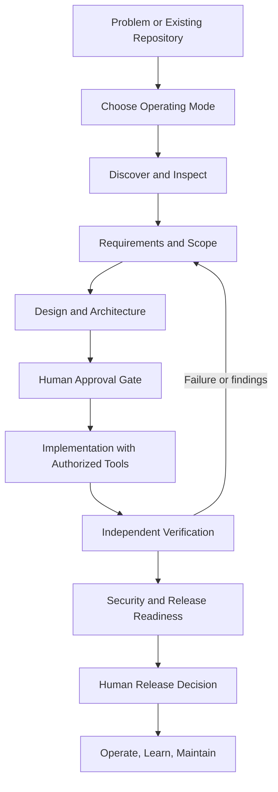

<div align="center">

# AISDF
### AI Software Development Framework

**From problem discovery to production-ready software — with humans in control.**

<p align="center">
  
</p>

[Getting Started](QUICK-START.md) · [Project Definition](PROJECT.md) · [MK Framework](01-METHODOLOGY/MK-FRAMEWORK/README.md) · [Documentation](docs/README.md) · [Workflows](workflows/) · [Runtime](docs/WORKFLOW-RUNTIME.md) · [Contributing](CONTRIBUTING.md)

</div>

---

## What is AISDF?

AISDF is an open, tool-independent software engineering framework and repository. It organizes the methods, governance rules, engineering knowledge, workflows, prompts, schemas, templates, validation tools, and AI-tool adapters needed to build and improve software systematically.

AISDF is **not** a hosted application, an LLM, an IDE, an autonomous agent platform, or a guarantee of production quality. Humans own product decisions, approvals, security acceptance, and releases. Compatible AI tools can assist within explicitly granted permissions.

## Why AISDF exists

AI-assisted development can produce code quickly while leaving gaps in requirements, architecture, security, maintainability, testing, and operational readiness. AISDF provides a repeatable lifecycle and evidence-based controls so teams can move quickly without treating generated output as verified software.

## How it works



1. **Choose a mode:** problem discovery, new project, or existing-project X-Ray.
2. **Load governance:** read the core principles and rulebook before acting.
3. **Create evidence artifacts:** project profile, requirements, design, risk and decision records.
4. **Pass approval gates:** do not implement or expand scope before required human approval.
5. **Execute in the host tool:** use the appropriate adapter and least-privilege permissions.
6. **Verify independently:** run tests, security checks, review changes, and record actual evidence.
7. **Report truthfully:** distinguish proposed, implemented, tested, independently verified, and production-verified work.

## Operating modes

| Mode | Use it when | Primary outcome |
|---|---|---|
| Problem Discovery | The problem or opportunity is not validated | Evidence-backed problem and go/defer/stop decision |
| New Project | Starting a new software product or capability | Approved requirements, design, implementation, and release evidence |
| Existing Project X-Ray | Working with an existing repository | Codebase map, risk/gap assessment, and controlled improvement plan |

## Repository map

| Path | Responsibility |
|---|---|
| `00-GOVERNANCE/` | Rules, policies, approval and release controls |
| `01-METHODOLOGY/`–`30-AGENT-RULES-AND-VERIFICATION/` | Engineering domains and technical standards; includes the optional [MK Framework](01-METHODOLOGY/MK-FRAMEWORK/README.md) venture-to-software method |
| `engines/` | Capability specifications and contracts |
| `modes/` | Operating-mode procedures |
| `workflows/` | Ordered, repeatable workflows including WF-001–WF-013 |
| `prompts/` | Entry prompts and role prompts |
| `schemas/`, `templates/`, `registries/` | Structured contracts and reusable artifacts |
| `tools/aisdf_runtime/` | Portable WF-007–WF-013 workflow helpers; project lifecycle CLI |
| `tests/` | Repository validation and tests |
| `adapters/` | Claude Code, Codex, Cursor, Antigravity integrations |
| `docs/` | Documentation index, coverage catalogue, assessments |
| `.github/workflows/` | Automated repository quality gate |

## Project definition and agent instructions

Every target project should maintain two complementary files: `PROJECT.md` describes the problem, users, functions/features, requirements, constraints, architecture, acceptance criteria, gaps and approvals; `AGENTS.md` tells coding agents how to work safely in that repository. AISDF includes a project template, assessment workflow, implementation-plan generator, and approval-gated execution-prompt generator. See [PROJECT.md and AGENTS.md guide](docs/project-lifecycle/PROJECT-AND-AGENT-FILES.md) and [WF-013](workflows/WF-013-PROJECT-DEFINITION-ASSESSMENT-AND-IMPLEMENTATION-PLANNING.md).

## Quick start

**Read first:** [Quick Start](QUICK-START.md), [Mission and Scope](AISDF-MISSION-AND-SCOPE.md), [Core Principles](AISDF-CORE-PRINCIPLES.md), and [Rulebook](00-GOVERNANCE/AISDF-RULEBOOK.md).

For the portable workflow runtime, see [WF-007–WF-012 Runtime Guide](docs/WORKFLOW-RUNTIME.md). For an existing project, use [WF-013](workflows/WF-013-PROJECT-DEFINITION-ASSESSMENT-AND-IMPLEMENTATION-PLANNING.md) and [Project Assessment Prompt](prompts/PROJECT-ASSESSMENT-ENTRY-PROMPT.md). For tool setup, see [Adapters](adapters/README.md). For the venture-to-software decision method, see the [MK Framework guide](01-METHODOLOGY/MK-FRAMEWORK/MK-FRAMEWORK.md) and its [visual overview](01-METHODOLOGY/MK-FRAMEWORK/assets/MK-FRAMEWORK-OVERVIEW.png).

## Validation

```bash
python -m pip install -r requirements-dev.txt
python tools/validate_repository.py
python -m pytest -q
python tools/aisdf_runtime/aisdf.py --help
```

## Current capability and maturity

- Governance, engineering domains, engine contracts, workflows, templates, and prompts are documented assets.
- WF-007–WF-013 have standard-library CLI helpers for creating and validating workflow artifacts.
- The CLI does not invoke LLMs, spawn isolated agents, modify application source code, or approve changes.
- Provider adapters are packaged instructions/configuration; live compatibility and certification must be tested in each host version.
- The reference project is a specification/validation fixture, not a completed production application.
- The project license decision remains pending. Do not assume a license has been granted.

See [Implementation Status](IMPLEMENTATION-STATUS.md) and [Release Readiness](RELEASE-READINESS.md).

## Contributing

Start with [CONTRIBUTING.md](CONTRIBUTING.md), [Code of Conduct](CODE_OF_CONDUCT.md), and the governance policies. Keep changes scoped, update tests and documentation, and never report checks that were not actually run.

## Security

Do not commit secrets, credentials, private keys, or sensitive user data. See [SECURITY.md](SECURITY.md) for reporting guidance and current disclosure limitations.

---

**Version:** 3.8.1 · **Framework maturity:** documented framework + limited executable workflow tooling · **License:** pending maintainer decision
