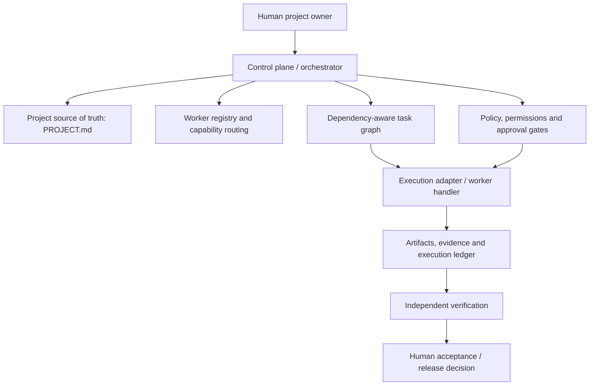
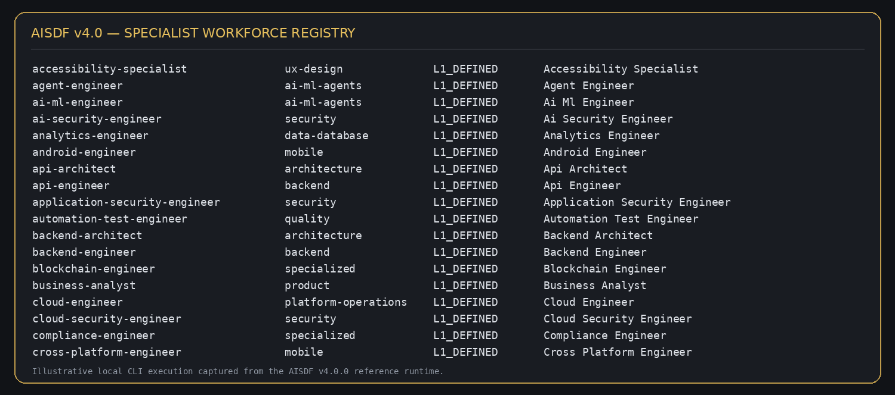
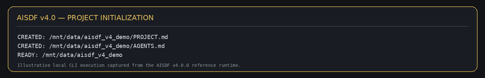
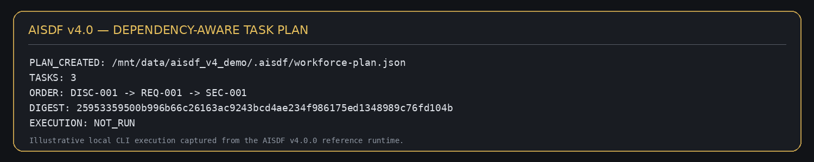
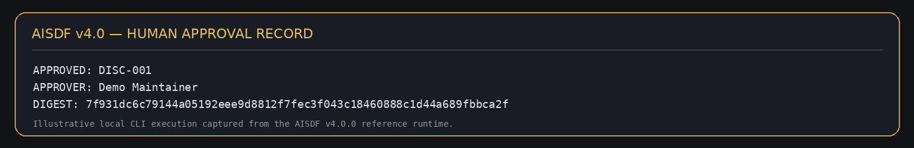
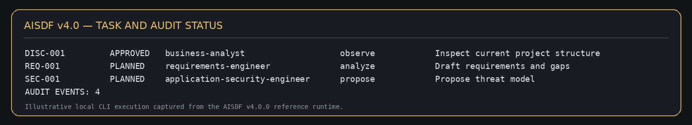

<div align="center">

# AISDF
### AI Software Development Framework

**Open-source, provider-independent software engineering workforce framework**

*Discover → Define → Design → Assign → Build → Verify → Operate → Improve*

[Quick Start](QUICK-START.md) · [Architecture](docs/v4/ARCHITECTURE.md) · [Workforce](workforce/README.md) · [Role Catalogue](workforce/ROLE-CATALOGUE.md) · [Operating Guide](docs/v4/OPERATING-GUIDE.md) · [Runtime](runtime/README.md) · [Security](security-operations/README.md) · [Project Setup](docs/project-lifecycle/PROJECT-AND-AGENT-FILES.md) · [Contributing](CONTRIBUTING.md)

**v4.0.0** · **Python 3.10+** · **MIT License**

</div>

---

## 1. What AISDF is

AISDF is an open-source framework and self-hostable reference runtime for coordinating software engineering work through specialist roles, explicit work contracts, policy-controlled permissions, dependency-aware plans, evidence records, human approvals, and independent verification.

It brings together product discovery, requirements, UX, architecture, frontend, backend, mobile, databases, APIs, AI/ML, agent engineering, security, QA, DevOps, cloud, SRE, release, operations, documentation, and maintenance in one governed engineering lifecycle.

AISDF is **not** an LLM, a proprietary AI provider, an IDE, or a claim that every specialist is an autonomous expert. The core runtime manages workers, tasks, state transitions, policy checks, approvals, budgets, and audit records. Model/provider adapters are optional extensions. A worker is considered operational only at the maturity level demonstrated by tests and runtime evidence.

## 2. What is included in v4.0.0

| Component | Included | Actual maturity |
|---|---|---|
| 31 engineering domains and prior standards | Yes | Documented |
| 56 engine specifications | Yes | Capability specifications |
| WF-001–WF-013 | Yes | Workflow specifications |
| MK Framework | Yes | Separate optional venture methodology |
| PROJECT.md + AGENTS.md templates | Yes | Executable project setup/check tooling |
| Specialist workforce catalogue | Yes | 72 role contracts and machine-readable manifests |
| Worker/task contracts | Yes | JSON schemas and runtime validation |
| Workforce registry | Yes | Executable local registry |
| Dependency-aware task planner | Yes | Executable DAG validation/planning |
| Permission policy | Yes | Executable policy checks for registered task actions |
| Human approval gates | Yes | Executable approval state and audit records |
| Budget controls | Yes | Task-level budget checks in the local runtime |
| SQLite execution ledger | Yes | Executable local persistence and audit trail |
| Provider adapters | Interface contracts | No provider is bundled or certified by default |
| Sandboxed code execution | Interface and policy requirements | External sandbox integration required; not claimed built-in |
| Persistent autonomous AI workers | Not included as a default service | Requires an explicitly configured model/runtime adapter |
| Security scanners | Tool contracts/catalogue | Install and certify tools separately |

This table is intentional: documented, executable, integrated, and production-certified are different states.

## 3. Why AISDF exists

AI-assisted development can produce code without reliably preserving project truth, requirements, scope, ownership, security boundaries, or test evidence. AISDF makes those controls explicit. It treats specialist workers as accountable roles, not chat personas: every assignment has a contract, owner, allowed actions, dependencies, acceptance criteria, evidence, budget, and handoff.

## 4. Core architecture



The local runtime is deterministic. It does not secretly call an LLM. To use model-powered workers, implement or install a provider adapter that conforms to `runtime/adapters/WORKER-ADAPTER-CONTRACT.md`, then explicitly configure credentials and permissions. The same worker contract can be executed by a human, a deterministic tool, or a configured model adapter.

## 5. Complete lifecycle — step by step

1. **Discover the project:** initialize `PROJECT.md` and `AGENTS.md`; inspect the repository; record facts, assumptions, unknowns, and evidence.
2. **Define requirements:** create stable feature/requirement IDs, user journeys, acceptance criteria, scope and exclusions.
3. **Design the system:** assign product, UX, architecture, data, API, security and infrastructure work to the relevant specialists.
4. **Approve the plan:** review dependencies, file scope, risks, budget and required permissions. Human approval is mandatory for controlled changes.
5. **Create work units:** split the plan into small tasks with explicit inputs, outputs, dependencies and acceptance criteria.
6. **Route work:** select workers by capability, project context, availability and policy—not by arbitrary agent count.
7. **Execute:** invoke a configured handler/adapter or assign the work to a human. The core runtime records state; it does not claim unconfigured AI execution.
8. **Review:** run functional, integration, security, performance, accessibility and independent reviews as applicable.
9. **Release:** verify evidence, unresolved findings, rollback and approvals. Human release authority remains final.
10. **Maintain:** update PROJECT.md, decisions, risks, memory and change history based on verified reality.

## 6. Workforce teams

AISDF ships role contracts for product/research, UX/design, architecture, frontend, mobile, backend, API/integration, database/data, AI/ML, agent engineering, security, QA, DevOps/cloud, SRE/observability, release/operations, documentation, accessibility, compliance, and independent assurance.

The complete catalogue is in [`workforce/teams/`](workforce/teams/). Workers are activated per project. A small demo does not need every role. A role definition is not proof of an autonomous implementation; see each manifest's `maturity` field.

## 7. Security operations

The security department is a first-class team covering security governance, threat modeling, secure architecture, application security, source review, dependency/supply-chain security, secrets, API security, cloud/container/IaC, IAM, privacy, AI/agent security, authorized penetration testing, incident response, remediation and independent retesting.

All offensive testing requires written authorization, target scope, time window, rate limits, and stop conditions. The runtime does not provide an OS sandbox. Never run untrusted code with host credentials. Use an external sandbox and least-privilege credentials for execution adapters.

## 8. Quick start

Requirements: Python 3.10+; no mandatory third-party runtime dependency.

```bash
# Validate the repository
python tools/validate_repository.py

# Run tests
python -m unittest discover -s tests -v

# Initialize a project (run from this repository root)
python tools/aisdf_runtime/workforce.py init --project ../my-project --name "My Project"

# List specialist workers
python tools/aisdf_runtime/workforce.py workers

# Create a work plan from a JSON task file
python runtime/aisdf_runtime/workforce.py plan --project ../my-project --tasks examples/tasks.example.json

# Inspect task plan and policy decisions
python tools/aisdf_runtime/workforce.py status --project ../my-project
```

Detailed steps: [`QUICK-START.md`](QUICK-START.md), [`runtime/README.md`](runtime/README.md), and [`docs/v4/GETTING-STARTED.md`](docs/v4/GETTING-STARTED.md).

## 9. Repository map

```text
AISDF/
├── README.md, PROJECT.md, AGENTS.md, LICENSE, VERSION
├── 00-GOVERNANCE/                 # Global rules, evidence and approvals
├── 01-METHODOLOGY/               # MK Framework (separate methodology)
├── 02-...-30-.../                # 31 engineering domains
├── engines/                      # 56 capability specifications
├── workflows/                    # WF-001 through WF-013
├── workforce/                    # Teams, role contracts, manifests, schemas
├── runtime/                      # Control plane, task graph, policy, ledger
├── security-operations/           # Security program and workflows
├── adapters/                     # Host/provider adapter contracts
├── tools/                        # CLI, validators and utility tooling
├── schemas/                      # Shared JSON schemas
├── templates/                    # Project, agent, task and report templates
├── examples/                     # Runnable examples and sample projects
├── tests/                        # Unit, integration and policy tests
└── .github/workflows/            # CI validation
```

## 10. See the v4.0 workforce runtime working

These screenshots are generated from actual local CLI executions against a disposable synthetic project. They demonstrate registry discovery, project initialization, task planning, human approval recording, and status/audit inspection. They do not depict an autonomous model executing code.

### 1. Specialist worker registry


### 2. Initialize a project


### 3. Create a dependency-aware task plan


### 4. Record human approval


### 5. Inspect task state and audit events


**Demo boundary:** planning and approval are executable. Actual task execution requires a separately configured adapter or a human operator.

## 11. MK Framework is separate

MK Framework is an optional venture/opportunity methodology: problem/crowd validation, proven-model analysis, founder-market fit, inversion, premortem, kill criteria, timing, offer, product execution, feedback, reinvestment, moat defense and systemization. AISDF is the software engineering workforce. They connect at product/software execution, but neither is hidden inside the other. See [`01-METHODOLOGY/MK-FRAMEWORK/README.md`](01-METHODOLOGY/MK-FRAMEWORK/README.md).

## 12. Open-source principles

- Self-hostable core; no mandatory vendor account.
- Provider-neutral worker contracts and adapter interfaces.
- Transparent permissions and auditable task state.
- Reproducible tests and public issue tracking.
- Human control over destructive, external, security-sensitive and release actions.
- No fabricated execution, security certification, benchmark result or autonomy claim.

## 13. Maturity and non-goals

v4.0.0 provides an executable local control-plane foundation: registry loading, task DAG validation, task state, policy checks, human approval records, budget checks and SQLite audit persistence. It does not ship a cloud-distributed scheduler, browser/computer operator, production-grade multi-tenant server, built-in LLM, universal tool execution, OS sandbox, or certified scanner suite. These are extension points with explicit contracts and acceptance requirements, not silently implied capabilities.

## 14. Contributing and governance

Read [`CONTRIBUTING.md`](CONTRIBUTING.md), [`CODE_OF_CONDUCT.md`](CODE_OF_CONDUCT.md), [`GOVERNANCE.md`](GOVERNANCE.md), and [`SECURITY.md`](SECURITY.md). All changes require tests, documentation, security consideration, and truthful maturity labels. See [`CHANGELOG.md`](CHANGELOG.md) for release history.
