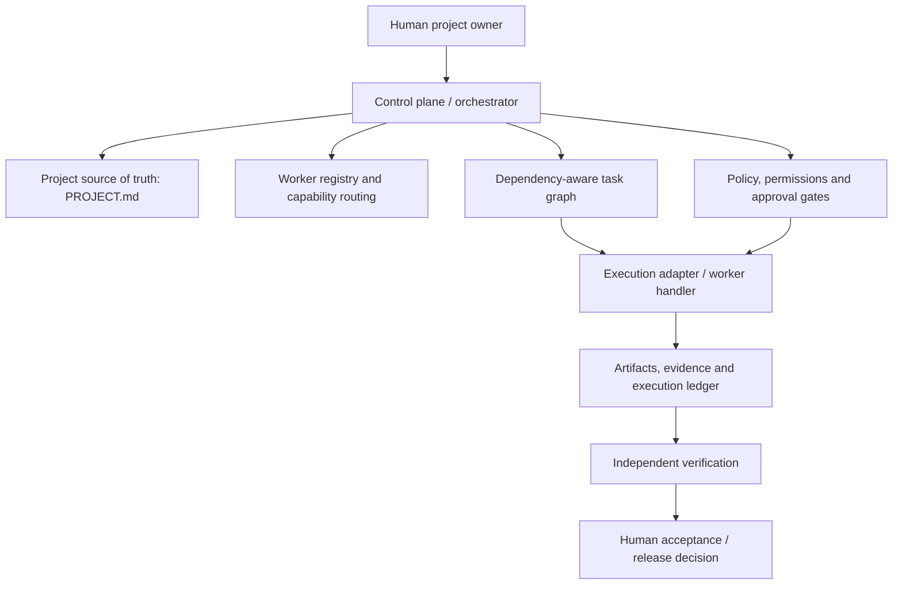

<div align="center">

# AISDF
### AI Software Development Framework

**Open-source, provider-independent software engineering workforce framework**

*Discover → Define → Design → Assign → Build → Verify → Operate → Improve*

[Quick Start](QUICK-START.md) · [Architecture](docs/framework/ARCHITECTURE.md) · [Workforce](workforce/README.md) · [Role Catalogue](workforce/ROLE-CATALOGUE.md) · [Operating Guide](docs/framework/OPERATING-GUIDE.md) · [Runtime](runtime/README.md) · [Security](security-operations/README.md) · [Project Setup](docs/project-lifecycle/PROJECT-AND-AGENT-FILES.md) · [Contributing](CONTRIBUTING.md)

**1.0.0** · **Python 3.10+** · **MIT License**

</div>

---

## 1. What AISDF is

AISDF is an open-source framework and self-hostable reference runtime for coordinating software engineering work through specialist roles, explicit work contracts, policy-controlled permissions, dependency-aware plans, evidence records, human approvals, and independent verification.

It brings together product discovery, requirements, UX, architecture, frontend, backend, mobile, databases, APIs, AI/ML, agent engineering, security, QA, DevOps, cloud, SRE, release, operations, documentation, and maintenance in one governed engineering lifecycle.

AISDF is **not** an LLM, a proprietary AI provider, an IDE, or a claim that every specialist is an autonomous expert. The core runtime manages workers, tasks, state transitions, policy checks, approvals, budgets, and audit records. Model/provider adapters are optional extensions. A worker is considered operational only at the maturity level demonstrated by tests and runtime evidence.

## 2. What is included in 1.0.0

| Component | Included | Actual maturity |
|---|---|---|
| 31 engineering domains, 56 engine specifications, WF-001-WF-013 | Yes | Specifications and workflows (instructions an AI follows) |
| MK Framework | Yes | Separate optional venture methodology |
| 72 specialist role contracts + manifests | Yes | Contracts with per-role permission profiles; **not** 72 autonomous agents |
| Local control-plane runtime (`python aisdf.py`) | Yes | **Implemented and tested** |
| Human approver allow-list, digest-bound approvals, dependency gating, no-fake-success | Yes | **Implemented and tested** |
| Hash-chained, tamper-evident audit ledger | Yes | **Implemented and tested** (tamper-evident, not tamper-proof) |
| Governed local command executor | Yes | **Implemented and tested**; process limits only, **not a sandbox** |
| Findings, release gate, independent-review package | Yes | **Implemented and tested** |
| Memory vault template + checker (Obsidian-compatible) | Yes | Implemented and tested |
| Pinned security-tool lock (12 tools, 2 CI actions) | Yes | Pins resolved; tools are not bundled or auto-run |
| Multi-tool adapters (Claude Code, Cursor, Antigravity, Kimi, Qwen...) | Compatibility matrix | **Not yet conformance-tested**; see `adapters/COMPATIBILITY.md` |
| Model/provider adapters | Interface contract | None bundled or certified |
| OS sandbox | No | Use a container/VM |
| Autonomous AI workers | No | Require a separately configured adapter |

Documented, implemented, tested and certified are different states. Only the rows marked implemented and tested are covered by the automated test suite. How each rule is enforced: [`docs/framework/RULES-AND-ENFORCEMENT.md`](docs/framework/RULES-AND-ENFORCEMENT.md).

## 3. Why AISDF exists

AI-assisted development can produce code without reliably preserving project truth, requirements, scope, ownership, security boundaries, or test evidence. AISDF makes those controls explicit. It treats specialist workers as accountable roles, not chat personas: every assignment has a contract, owner, allowed actions, dependencies, acceptance criteria, evidence, budget, and handoff.

## 4. Core architecture



The local runtime is deterministic. It does not secretly call an LLM. To use model-powered workers, implement or install a provider adapter that conforms to `runtime/adapters/WORKER-ADAPTER-CONTRACT.md`, then explicitly configure credentials and permissions. The same worker contract can be executed by a human, a deterministic tool, or a configured model adapter.

## 5. Complete lifecycle — step by step

1. **Discover the project:** initialize `PROJECT.md` and `AGENTS.md`; inspect the repository; record facts, assumptions, unknowns, and evidence.
2. **Define requirements:** create stable feature/requirement IDs, user journeys, acceptance criteria, scope and exclusions.
3. **Design the system:** assign product, UX, architecture, data, API, security and infrastructure work to the relevant specialists.
4. **Approve the plan:** review dependencies, file scope, risks, budget and required permissions. Human approval is mandatory for controlled changes.
5. **Create work units:** split the plan into small tasks with explicit inputs, outputs, dependencies and acceptance criteria.
6. **Route work:** select workers by capability, project context, availability and policy—not by arbitrary agent count.
7. **Execute:** invoke a configured handler/adapter or assign the work to a human. The core runtime records state; it does not claim unconfigured AI execution.
8. **Review:** run functional, integration, security, performance, accessibility and independent reviews as applicable.
9. **Release:** verify evidence, unresolved findings, rollback and approvals. Human release authority remains final.
10. **Maintain:** update PROJECT.md, decisions, risks, memory and change history based on verified reality.

## 6. Workforce teams

AISDF ships role contracts for product/research, UX/design, architecture, frontend, mobile, backend, API/integration, database/data, AI/ML, agent engineering, security, QA, DevOps/cloud, SRE/observability, release/operations, documentation, accessibility, compliance, and independent assurance.

The complete catalogue is in [`workforce/teams/`](workforce/teams/). Workers are activated per project. A small demo does not need every role. A role definition is not proof of an autonomous implementation; see each manifest's `maturity` field.

## 7. Security operations

The security department is a first-class team covering security governance, threat modeling, secure architecture, application security, source review, dependency/supply-chain security, secrets, API security, cloud/container/IaC, IAM, privacy, AI/agent security, authorized penetration testing, incident response, remediation and independent retesting.

All offensive testing requires written authorization, target scope, time window, rate limits, and stop conditions. The runtime does not provide an OS sandbox. Never run untrusted code with host credentials. Use an external sandbox and least-privilege credentials for execution adapters.

## 8. Quick start

Requirements: Python 3.10+; no mandatory third-party runtime dependency.

```bash
python tools/validate_repository.py            # repository validator
python -m unittest discover -s tests -v        # full test suite

# In a real terminal (approvals need a human at a keyboard):
python aisdf.py init --project ../my-project --name "My Project" --owner "Your Name"
python aisdf.py plan --project ../my-project --tasks examples/tasks.example.json
python aisdf.py approve --project ../my-project --task-id DISC-001 --approver "Your Name"
python aisdf.py transition --project ../my-project --task-id DISC-001 --to READY
python aisdf.py complete --project ../my-project --task-id DISC-001 --actor "Your Name" --result SUCCEEDED --evidence notes.md
python aisdf.py status --project ../my-project
python aisdf.py verify-ledger --project ../my-project
python aisdf.py gate --project ../my-project     # release gate (BLOCKED lists every reason)
```

Details: [`QUICK-START.md`](QUICK-START.md), [`runtime/README.md`](runtime/README.md), [`docs/framework/GETTING-STARTED.md`](docs/framework/GETTING-STARTED.md). Using it from a specific AI tool: [`adapters/COMPATIBILITY.md`](adapters/COMPATIBILITY.md).

## 9. Repository map

```text
AISDF/
├── README.md, PROJECT.md, AGENTS.md, LICENSE, VERSION
├── 00-GOVERNANCE/                 # Global rules, evidence and approvals
├── 01-METHODOLOGY/               # MK Framework (separate methodology)
├── 02-...-30-.../                # 31 engineering domains
├── engines/                      # 56 capability specifications
├── workflows/                    # WF-001 through WF-013
├── workforce/                    # Teams, role contracts, manifests, schemas
├── runtime/                      # Control plane, task graph, policy, ledger
├── security-operations/           # Security program and workflows
├── adapters/                     # Host/provider adapter contracts
├── tools/                        # CLI, validators and utility tooling
├── schemas/                      # Shared JSON schemas
├── templates/                    # Project, agent, task and report templates
├── examples/                     # Runnable examples and sample projects
├── tests/                        # Unit, integration and policy tests
└── .github/workflows/            # CI validation
```

## 10. See it working

[`docs/demo/TRANSCRIPT.md`](docs/demo/TRANSCRIPT.md) is a real, unedited transcript of the runtime refusing an AI-named approver, blocking a task whose dependency has not finished, revoking an approval after a scope change, running an allow-listed command with redacted evidence, detecting a tampered ledger, and blocking a release. Regenerate it with `bash examples/demo.sh`. (Screenshots from the pre-hardening 4.0.0 runtime are kept in `docs/demo/legacy-v4-captures/` for history only.)

## 11. MK Framework is separate

MK Framework is an optional venture/opportunity methodology: problem/crowd validation, proven-model analysis, founder-market fit, inversion, premortem, kill criteria, timing, offer, product execution, feedback, reinvestment, moat defense and systemization. AISDF is the software engineering workforce. They connect at product/software execution, but neither is hidden inside the other. See [`01-METHODOLOGY/MK-FRAMEWORK/README.md`](01-METHODOLOGY/MK-FRAMEWORK/README.md).

## 12. Open-source principles

- Self-hostable core; no mandatory vendor account.
- Provider-neutral worker contracts and adapter interfaces.
- Transparent permissions and auditable task state.
- Reproducible tests and public issue tracking.
- Human control over destructive, external, security-sensitive and release actions.
- No fabricated execution, security certification, benchmark result or autonomy claim.

## 13. Maturity and non-goals

1.0.0 is a governed local control plane: enforced approvals, dependency gating, evidence-backed completion, a tamper-evident ledger, a governed executor, findings, a release gate and an independent-review package. It does **not** ship a model adapter, a sandbox, scanner execution, a hosted service, or evidence that any AI tool follows the rules perfectly. A gate PASS means the recorded evidence satisfies the policy; it is not a proof that software is secure or correct, and the release decision stays human. "Best in the world" is not claimed; the measurable goals are in [`docs/framework/POSITIONING-AND-ROADMAP.md`](docs/framework/POSITIONING-AND-ROADMAP.md).

## 14. Contributing and governance

Read [`CONTRIBUTING.md`](CONTRIBUTING.md), [`CODE_OF_CONDUCT.md`](CODE_OF_CONDUCT.md), [`GOVERNANCE.md`](GOVERNANCE.md), and [`SECURITY.md`](SECURITY.md). All changes require tests, documentation, security consideration, and truthful maturity labels. See [`CHANGELOG.md`](CHANGELOG.md) for release history.
