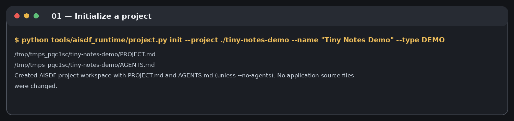
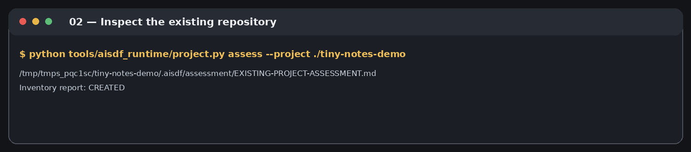
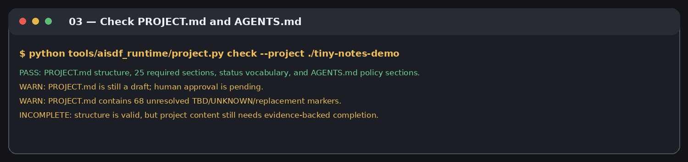
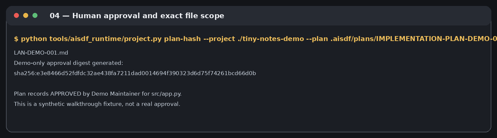
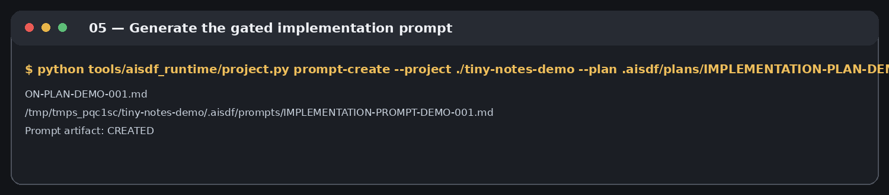

# AISDF CLI Demo — From Repository to Approved Implementation Prompt

This walkthrough demonstrates the actual local project lifecycle helper against a synthetic Python repository named `Tiny Notes Demo`.

## Prerequisites

- Python 3.10+
- A copy/clone of AISDF
- A target project folder you own or are authorized to inspect

## Step 1 — Initialize

From the AISDF repository root:

```bash
python tools/aisdf_runtime/project.py init --project ../tiny-notes-demo --name "Tiny Notes Demo" --type DEMO
```

Creates `PROJECT.md`, `AGENTS.md`, and `.aisdf/` folders. It refuses to overwrite existing project documents. Use `--no-agents` only if you deliberately do not want a generated root `AGENTS.md`.



## Step 2 — Create a repository inventory

```bash
python tools/aisdf_runtime/project.py assess --project ../tiny-notes-demo
```

Creates `.aisdf/assessment/EXISTING-PROJECT-ASSESSMENT.md`. This is a deterministic file inventory and detected-artifact report. It is not semantic feature analysis.



## Step 3 — Ask a connected AI agent to assess the real project

Open the actual target repository in ChatGPT Work with file access, Claude Code, Codex, Cursor, or Antigravity. Give it `prompts/PROJECT-ASSESSMENT-ENTRY-PROMPT.md` and ask it to follow WF-002/WF-013.

The agent must inspect source code, tests, docs, manifests, migrations, APIs, permissions, dependencies, CI and deployment configuration. It must map each feature to evidence and use the status vocabulary in `PROJECT.md`. It must not implement changes during assessment.

Review the proposed `PROJECT.md` updates and findings. Do not accept guessed or unsupported claims.

## Step 4 — Check document structure

```bash
python tools/aisdf_runtime/project.py check --project ../tiny-notes-demo
```

The checker validates 25 required headings, metadata, status vocabulary, duplicate IDs, and AGENTS policy sections. A new template should show warnings while fields remain placeholders or the approval status remains draft. That is expected.

```bash
python tools/aisdf_runtime/project.py check --project ../tiny-notes-demo --json
python tools/aisdf_runtime/project.py check --project ../tiny-notes-demo --strict
```

`--strict` returns a non-zero exit code while warnings remain. This is useful for a project that wants a completed-document gate. The checker cannot validate the truth of the project narrative or prove features work.



## Step 5 — Create an implementation plan

After the human has reviewed the assessment and approved the requirements/scope:

```bash
python tools/aisdf_runtime/project.py plan-create --project ../tiny-notes-demo --id P001 --title "First improvement"
```

Fill the plan with requirement IDs, findings, dependencies, exact files, data/API impact, tests, security considerations, rollback, and out-of-scope work. Do not use wildcard paths in the file allowlist.

## Step 6 — Approve the exact plan revision

After the plan is final:

```bash
python tools/aisdf_runtime/project.py plan-hash --project ../tiny-notes-demo --plan .aisdf/plans/IMPLEMENTATION-PLAN-P001.md
```

An authorized human records `APPROVED`, their name, date, the exact digest, and exact approved file allowlist in the plan. If plan content changes, compute a new digest and obtain approval again.



## Step 7 — Generate the implementation prompt

```bash
python tools/aisdf_runtime/project.py prompt-create --project ../tiny-notes-demo --plan .aisdf/plans/IMPLEMENTATION-PLAN-P001.md
```

The command checks the approval record, digest, and file allowlist. It then creates `.aisdf/prompts/IMPLEMENTATION-PROMPT-P001.md` for the connected coding agent.



## Step 8 — Implement and verify in the real repository

The connected agent reads `PROJECT.md`, `AGENTS.md`, the approved plan, and generated prompt. It implements only the approved files, runs the plan's tests, checks the Git diff, and reports evidence. Humans retain approval of scope, security acceptance, and release.

## What the CLI does and does not do

| CLI action | Does | Does not |
|---|---|---|
| `init` | Creates reusable project docs and workspace | Does not inspect or rewrite application source |
| `assess` | Inventories files and known project artifacts | Does not understand whether a feature works |
| `check` | Checks document structure and basic consistency | Does not prove statements are true or complete semantically |
| `plan-create` | Creates a draft implementation plan | Does not approve it |
| `plan-hash` | Computes a digest for the plan body | Does not identify or authenticate the human approver |
| `prompt-create` | Generates an execution prompt after gate checks | Does not implement code or guarantee host enforcement |

The screenshots are actual local CLI output captures from a temporary synthetic project. The synthetic approval is only for demonstration.
