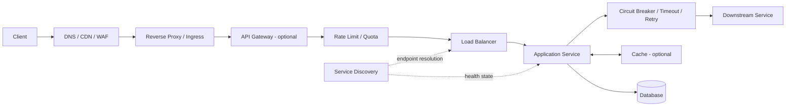

# Reference Architecture: Request Path and Delivery Path

These are logical reference patterns. Omit components that are not justified by workload, risk, scale, team capability, or operating budget.

## Runtime request path

A reverse proxy, API gateway, ingress controller, and load balancer can be separate products or combined capabilities. Document which layer owns TLS termination, routing, authentication, quotas, request transformation, and observability. Avoid duplicate policy enforcement without a clear precedence model.

## Delivery path

```mermaid
flowchart LR
  DEV[Commit / Pull Request] --> CI[CI: lint, test, scan]
  CI --> ART[Build immutable artifact]
  ART --> REG[Container / Artifact Registry]
  REG --> CD[CD: deploy to staging]
  CD --> VERIFY[Smoke, integration, security checks]
  VERIFY --> APPROVE[Human release approval]
  APPROVE --> PROD[Production rollout]
  PROD --> OBS[Metrics, logs, traces, alerts]
  OBS --> RB[Rollback / Forward fix]
```

## Key design rule
Use one authoritative owner for each concern. For example, avoid independently configured rate limits at the gateway and application unless layered defense is intentional and the combined behavior is tested.
